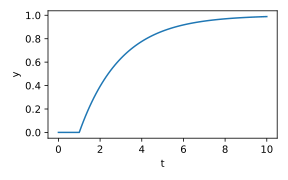
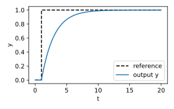

# CasADi Dynamic Models

Python tools to define and combine dynamic system models in [CasADi](https://web.casadi.org)
for use in nonlinear modelling, dynamic optimization and control.

## Key features

 - Construct large complex system models by connecting sub-models
 - Combine custom nonlinear models with standard linear dynamical systems
 - Python classes keep track of variable names (inputs, states, outputs and parameters) when connecting and combining models.
 - Built with CasADi's high-performance functions which are automatically differentiable
 - Uses CasADi's built-in integrators to simulate or discretize continuous time models
 - Model parameters can be symbolic, allowing them to be included in optimization problems
 - Supports both continuous and discrete time models

## Use Cases

Add linear dynamical systems to a nonlinear model to introduce simple identifiable dynamics.

Use nonlinear constrained optimization to identify the parameters of linear dynamic systems
(see [Examples: Parameter Estimation](#examples-parameter-estimation)).

Easily construct and evaluate different model structures.

I'm not aware of a system identification toolbox for CasADi models so I developed these
tools to identify and simulate simple dynamical systems for my projects.

Note this is still a work-in-progress and only a small subset of possible model types have been
implemented.

## Examples: Building Models

```python
from cas_models.continuous_time.models import (
    StateSpaceModelCT, SSModelCTLinearFOSISO, SSModelCTLinearO2NoGainSISO
)
from cas_models.transformations import connect_systems_in_series

# First order, single-input, single-output, continuous-time
# state-space model with symbolic parameters
sys_model = SSModelCTLinearFOSISO()
print(sys_model.f)
# f:(t,x,u,K,T1)->(rhs) SXFunction
print(sys_model.h)
# h:(t,x,u,K,T1)->(y) SXFunction
```

Alternatively, some or all model parameters can be set to constants.
```python
sys_model = SSModelCTLinearFOSISO(K=2.5)
print(sys_model.f)
# f:(t,x,u,T1)->(rhs) SXFunction
print(sys_model.h)
# h:(t,x,u,T1)->(y) SXFunction
```

```python
sys_model_2 = SSModelCTLinearO2NoGainSISO()
print(sys_model_2.f)
# f:(t,x[2],u,T1,T2)->(rhs[2]) SXFunction
print(sys_model_2.h)
# h:(t,x[2],u,T1,T2)->(y) SXFunction
```

```python
# Combine both systems by connecting in series
sys = connect_systems_in_series([sys_model, sys_model_2], model_class=StateSpaceModelCT)
print(sys.f)
# f:(t,x[3],u,sys1_T1,sys2_T1,T2)->(rhs[3]) SXFunction
print(sys.h)
# h:(t,x[3],u,sys1_T1,sys2_T1,T2)->(y) SXFunction
```

```python
# The '*' operator follows the matrix-multiplication convention:
# the rightmost operand acts first on the input.
# sys_model_2 * sys_model: u -> sys_model -> sys_model_2 -> y
sys = sys_model_2 * sys_model
```

## Connecting Models

The functions in `cas_models.transformations` (for continuous-time and
discrete-time models alike):

| Function | Operator | Inputs | Outputs | Transfer matrix |
|---|---|---|---|---|
| `connect_systems_in_series` | `sys2 * sys1` | sys1's | sys2's | G2 G1 |
| `connect_systems_in_parallel` | `sys1 + sys2` | shared | summed | G1 + G2 |
| `hstack_systems` | | separate | summed | [G1, G2] |
| `vstack_systems` | | shared | stacked | [G1; G2] |
| `block_diag_systems` | | separate | stacked | [G1, 0; 0, G2] |
| `connect_feedback_system` | | | | feedback loop |
| `connect_systems` | | named signal connections, the most general | | |
| `negate_system` | `-sys` | | negated | -G |

`sys1 - sys2` is `sys1 + (-sys2)`. The names follow Matlab and
python-control: `parallel()` there is `connect_systems_in_parallel`,
`append()` is `block_diag_systems`. Before 2026-11,
`connect_systems_in_parallel` was the block-diagonal combination and
`sum_systems` the parallel one.

## Examples: Simulation

```python
import numpy as np
import matplotlib.pyplot as plt

from cas_models.continuous_time.models import SSModelCTLinearFOSISO
from cas_models.discrete_time.models import StateSpaceModelDTFromCT
from cas_models.discrete_time.simulate import make_n_step_simulation_function_from_model

# Continuous time model
sys_ct = SSModelCTLinearFOSISO(K=1, T1=2)

# Convert to discrete-time with dt=0.1
dt = 0.1
sys_dt = StateSpaceModelDTFromCT(sys_ct, dt)
print(sys_dt.F)
# F:(t,xk,uk)->(xkp1) SXFunction
print(sys_dt.H)
# H:(t,xk,uk)->(yk) SXFunction
```

```python
# Number of time-steps to simulate
nT = 100
simulate = make_n_step_simulation_function_from_model(sys_dt, nT)
print(simulate)
# F_sim_100_steps:(t_eval[101],U[100],x0)->(X[101],Y[101]) SXFunction
```

```python
# Simulation time
# Note: Simulation outputs include values for nT+1 time instants
t = dt * np.arange(nT + 1)
t_in = t[:-1]

# Simulation inputs
U = np.zeros((nT, 1))
U[t_in >= 1] = 1.0

# Initial condition
x0 = np.zeros(sys_dt.n)
X, Y = simulate(t, U, x0)

assert X.shape == (nT + 1, sys_dt.n)   # states
assert Y.shape == (nT + 1, sys_dt.ny)  # outputs
```

```python
# Make time-series plot
fig, ax = plt.subplots(figsize=(4, 2.5))
ax.plot(t, Y[:, 0])
ax.set_xlabel("t")
ax.set_ylabel("y")
ax.grid(False)
plt.tight_layout()
plt.show()
```


## Examples: Simulating a Feedback Loop

```python
from cas_models.continuous_time.regulators import SSModelCTPIInt
from cas_models.transformations import connect_feedback_system

# First-order plant: G(s) = 1 / (2s + 1)
plant = SSModelCTLinearFOSISO(K=1, T1=2, name="plant")
plant.describe()
# SSModelCTLinearFOSISO:
#   Name: plant
#   f:(t,x,u)->(rhs) SXFunction
#   h:(t,x,u)->(y) SXFunction
#   States (n=1): ['x']
#   Inputs (nu=1): ['u']
#   Outputs (ny=1): ['y']
#   Parameters: []
```

```python
# PI controller: Gc(s) = Kc * (Ti*s + 1) / (Ti*s)
ctrl = SSModelCTPIInt(name="ctrl")
ctrl.describe()
# SSModelCTPIInt:
#   Name: ctrl
#   f:(t,x,u,Kc,Ti)->(rhs) SXFunction
#   h:(t,x,u,Kc,Ti)->(y) SXFunction
#   States (n=1): ['x']
#   Inputs (nu=1): ['e']
#   Outputs (ny=1): ['u']
#   Parameters: ['Kc', 'Ti']
```

```python
# First, join controller and plant in series: u -> ctrl -> plant -> y
sys1 = plant * ctrl
sys1.describe()
# StateSpaceModelCT:
#   Name: ctrl_plant
#   f:(t,x[2],u,Kc,Ti)->(rhs[2]) SXFunction
#   h:(t,x[2],u,Kc,Ti)->(y) SXFunction
#   States (n=2): ['plant_x', 'ctrl_x']
#   Inputs (nu=1): ['e']
#   Outputs (ny=1): ['y']
#   Parameters: ['Kc', 'Ti']
```

```python
# Negative feedback loop: reference -> ctrl -> plant -> (feedback) -> ctrl
sys_cl = connect_feedback_system(sys1, model_class=StateSpaceModelCT)
sys_cl.describe()
# StateSpaceModelCT:
#   Name: fbk_ctrl_plant
#   f:(t,x[2],u,Kc,Ti)->(rhs[2]) SXFunction
#   h:(t,x[2],u,Kc,Ti)->(y) SXFunction
#   States (n=2): ['plant_x', 'ctrl_x']
#   Inputs (nu=1): ['y_sp']
#   Outputs (ny=1): ['y']
#   Parameters: ['Kc', 'Ti']
```

```python
# Convert to discrete-time and simulate step response
dt = 0.1
sys_cl_dt = StateSpaceModelDTFromCT(sys_cl, dt)

nT = 200
simulate_cl = make_n_step_simulation_function_from_model(sys_cl_dt, nT)
# Function(F_sim_200_steps:(t_eval[201],U[200],x0[2],Kc,Ti)->(X[201x2],Y[201]) SXFunction)
```

```python
t = dt * np.arange(nT + 1)
R_full = np.where(t >= 1, 1.0, 0.0)      # reference at all nT+1 time instants
R = R_full[:-1].reshape(-1, 1)            # inputs at nT steps

# Set parameters for simulation
Kc, Ti = 1, 2
x0 = np.zeros(sys_cl_dt.n)
X, Y = simulate_cl(t, R, x0, Kc, Ti)

assert X.shape == (nT + 1, sys_cl_dt.n)
assert Y.shape == (nT + 1, sys_cl_dt.ny)
```

```python
fig, ax = plt.subplots(figsize=(4, 2.5))
ax.step(t, R_full, "k--", where="post", label="reference")
ax.plot(t, Y[:, 0], label="output y")
ax.set_xlabel("t")
ax.set_ylabel("y")
ax.legend()
plt.tight_layout()
plt.show()
```


## Examples: Parameter Estimation

`estimate_params` fits a model's symbolic parameters to input-output data by
minimizing the sum of squared output errors (the output-error method) with
`cas.Opti` and IPOPT. There are two versions with the same arguments:

- `cas_models.discrete_time.estimate`: discrete-time models.
- `cas_models.continuous_time.estimate`: continuous-time models, simulated
  with RK4 over the time steps in `t`, which can be irregular (inputs held
  between samples). `n_sub` sets the number of RK4 substeps per time step.
  RK4 is unstable if a substep is longer than about 2.8 times the smallest
  time constant, so bound the time constants from below.

```python
import numpy as np
from cas_models.continuous_time.models import SSModelCTLinearFOSISO
from cas_models.continuous_time.estimate import estimate_params
from cas_models.continuous_time.simulate import make_n_step_simulation_function_RK4

# Data: a first-order system sampled at irregular times
rng = np.random.default_rng(0)
nT = 100
t = np.cumsum(np.r_[0.0, rng.uniform(0.2, 1.0, nT)])
U = np.where(t[:-1] % 20 < 10, 1.0, 0.0).reshape(-1, 1)
simulate = make_n_step_simulation_function_RK4(SSModelCTLinearFOSISO(K=2, T1=3), nT, n_sub=4)
_, Y = simulate(t, U, np.zeros(1))

# Estimate K and T1 from the data
sys_model = SSModelCTLinearFOSISO()
params_est, _, sol = estimate_params(
    sys_model,
    t,
    U,
    Y.full(),
    params_init={"K": 1.0, "T1": 1.0},
    param_bounds={"T1": (0.1, None)},
    solver_options={"print_level": 0},
    n_sub=4,
)
print(params_est)
# {'K': 2.000000000020711, 'T1': 3.0000000002056453}
```

Other options:

- `n_steps`: multiple shooting in segments of `n_steps` time steps (more
  robust for slow or unstable models; the default is single shooting).
- `estimate_x0=True`: also estimate the initial state.
- `solver_options`: IPOPT options, e.g.
  `{"hessian_approximation": "limited-memory"}` (the exact Hessian is the
  default and usually converges faster).

`prediction_errors` and `prediction_errors_ms` return the output errors as
CasADi expressions, for building your own estimation problem.
[system_identification_example.ipynb](system_identification_example.ipynb)
is a complete example.

`StateSpaceModelDTARXSISO` is an ARX model with the same polynomials as
MATLAB's `arx` and `filter([zeros(1, nk) B], [1 A], u)`. Octave's `arx`
counts the delay `nk` one less (see the class docstring).

## Saving and Loading Models

### Model folders

`save()` writes a model to a folder of readable files, which `load_model()`
reads back:

```python
from cas_models.yaml_utils import load_model

model.save("models/R11")                      # overwrite=True to replace
model = load_model("models/R11")              # any model
model = StateSpaceModelDT.load("models/R11")  # a DT model, or an error
```

`SomeClass.load()` accepts only that class or one of its subclasses.

The folder holds `model.yaml`: the model's class and the arguments of its
`__init__` that rebuild it, leaving out those equal to their defaults
(here `T1` and `T2`, so they are symbolic):

```yaml
cas_models_format: 1
class: SSModelCTLinearO2SISO
args: {K: 2.0}
```

A model with no arguments to give is written on one line,
`{cas_models_format: 1, class: SSModelCTLinearFOSISO}`. A model given as
an argument, such as the `model_ct` of `StateSpaceModelDTFromCTRK4`, is
written as a nested `{class: ..., args: ...}`.

Vectors of up to 8 elements and matrices of up to 5 x 5 are written in
`model.yaml`, a column vector as a list and other matrices as a list of
rows; larger ones go to tab-separated text files in the folder, one row
per line, which `model.yaml` refers to:

```yaml
args:
  A:
    file: A.tsv
    shape: [6, 6]
  B:
    DM: [1.0, 0.0, 0.0, 0.0, 0.0, 0.0]
  C:
    DM:
    - [0.5, 0.5, 0.0, 0.0, 0.0, 0.0]
  D:
    DM: [0.0]
```

Values are written in full precision, and sparse matrices dense (the
constructors sparsify their matrices).

Models built by connecting others (`connect_systems`,
`connect_systems_in_parallel`, `hstack_systems`, `connect_feedback_system`,
`*`, `+`, `-`, ...) are instances of the base classes,
`StateSpaceModelCT` and `StateSpaceModelDT`, whose arguments are the
functions `f` and `h` (`F` and `H`). These go to `.casadi` files
(CasADi's serialization of the expression graph, exact but not readable),
and `model.yaml` holds the dimensions, the names, and the parameters'
names and shapes. Symbolic parameters load as new symbols with the same
names; parameter values (e.g. fitted ones) aren't saved.

For now, `save()` writes every model in this base-class form, so it loads
as `StateSpaceModelCT` or `StateSpaceModelDT`; files holding a subclass's
arguments (as in `tests/data/models`) load as that subclass.

### Models built from others

A model file (or YAML text, `from_yaml()`) can also say how to build a
model from others: a connection function of `cas_models.transformations`
and its arguments, with the models it connects given in the same way,
to any depth:

```yaml
cas_models_format: 1
function: hstack_systems
args:
  name: R11
  systems:
  - class: StateSpaceModelDTARXSISO
    args: {na: 2, nb: 2, dt: 2.0, name: CRAC1}
  - class: StateSpaceModelDTARXSISO
    args: {na: 1, nb: 1, dt: 2.0, name: CRAC2}
```

Every model is a mapping of `class` or `function` and its `args` (named
arguments only); `cas_models_format` is only at the top. The functions:
`block_diag_systems`, `hstack_systems`, `vstack_systems`,
`connect_systems_in_parallel`, `connect_systems_in_series`,
`connect_systems`, `connect_feedback_system` and `negate_system`.
`model_class` can be left out: it is the base class
(`StateSpaceModelCT` or `StateSpaceModelDT`) of the models connected.

A symbolic argument is `{symbol: name}` (a scalar), or `{symbol: name,
shape: [n]}` (a column vector) or `shape: [n, m]` (a matrix), wherever a
value can go, e.g. `poles: [{symbol: p_0}, 0.5]`. The same name in one
document is the same symbol, so the models that use it share the
parameter (one `K` here, not `a_K` and `b_K`):

```yaml
cas_models_format: 1
function: vstack_systems
args:
  systems:
  - class: SSModelCTLinearO2SISO
    args: {K: {symbol: K}, T1: {symbol: T1}, T2: 5.0, name: a}
  - class: SSModelCTLinearFOSISO
    args: {K: {symbol: K}, T1: {symbol: T1}, name: b}
```

The parameter is named after the symbol, not the argument (a vector's
elements are `name_0`, `name_1`, ..., as CasADi names them).

`save()` and `to_yaml()` write these files too: every model records how
it was made (its class and the arguments given, or the connection
function and its arguments, the operators `*`, `+` and `-` included;
see `cas_models/recipes.py`), and that is what they write, to any
depth. A model made from functions, or with an argument that can't be
written (an expression such as `2 * K`), is written from its fields
instead. A model with fitted values, `set_param_values(model, values)`,
is written as that call: its structure from scratch and the values.

### Pickle

Models with fixed parameter values pickle like ordinary Python objects:

```python
import pickle

with open("model.pkl", "wb") as f:
    pickle.dump(model, f)
with open("model.pkl", "rb") as f:
    model = pickle.load(f)
```

Models with symbolic parameters pickle the same way for now, but this may
be withdrawn (see the TODO in `cas_models/pickle_utils.py`): a symbolic
model is a template, cheap to rebuild from code. CasADi pickles SX and MX
objects only inside a `cas.global_pickle_context()` (and loads them inside
a `cas.global_unpickle_context()`), and the models open one for themselves.
The loaded model has new symbols, shared within it as in the original
(e.g. a model's `params` and its expressions); symbols shared between
models stay shared only if they are pickled together inside a context:

```python
with cas.global_pickle_context():
    pickle.dump((model_a, model_b), f)
```

Pickle files are binary and tied to the class names in this package and to
the CasADi version.

## To do

- **Estimation statistics in fitted models:** a model saved after
  `set_param_values(model, params_est)` holds its structure and the
  values, but nothing about how they were found (standard errors,
  RMSE on the estimation and validation data, the data sets, solver
  status). Decide whether the fitted model (its recipe and YAML) should
  carry these, e.g. as an optional `info` mapping that loading keeps
  but ignores, or whether the user keeps them alongside, as
  `ffd-fit-models` does now (`models.yaml`, `stats.csv`).
